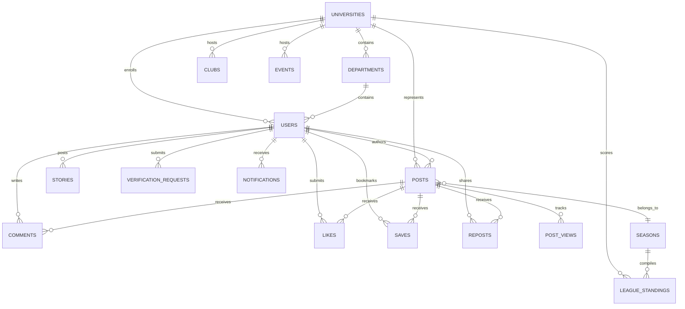

# Uni Vibe — Data Model Inventory & Entity Specifications

> **Scope:** Full inventory of all frontend entities, schema types, identifiers, relational mappings, and future FastAPI / SQLAlchemy requirements.  
> **Investigation Date:** October 2026  

---

## 1. Discovered Frontend Entities & Current Schemas

---

### 1.1 User Entity
- **Defined in:** `Frontend/src/data/mockUsers.js:6-26`, `Frontend/src/context/AuthProvider.jsx:80-101`, `Frontend/src/services/authService.js:37-57`
- **Primary Identifier:** `id` (`string`, e.g. `"u1"`, `"u_1729690000000"`)
- **Current Fields:**
  - `id`: `string` (Required)
  - `name`: `string` (Required)
  - `username`: `string` (Required, prefixed with `@`)
  - `email`: `string` (Required, unique)
  - `avatar`: `string` (URL)
  - `coverImage`: `string` (URL, optional / nullable)
  - `isStudent`: `boolean` (Required, true for student, false for explorer)
  - `verificationStatus`: `string` (`"none"` | `"pending"` | `"verified"` | `"rejected"`)
  - `verified`: `boolean` (Derived flag for UI badge)
  - `university`: `string` (University short name or display name)
  - `universityId`: `string` (Foreign key to University, nullable)
  - `department`: `string` (Display name, nullable)
  - `departmentId`: `string` (Foreign key to Department, nullable)
  - `year`: `string` (e.g. `"1st Year"`, `"3rd Year"`, nullable)
  - `bio`: `string` (Text)
  - `followers`: `number` (Count)
  - `following`: `number` (Count)
  - `vibeCount`: `number` (Count)
  - `leaguePT`: `number` (Cumulative contributor score)
- **Relationships:**
  - `belongs_to` University via `universityId`
  - `belongs_to` Department via `departmentId`
  - `has_many` Vibes (Posts)
  - `has_many` Stories
  - `has_many` Memberships (Clubs)
- **Inconsistencies & Gaps:**
  - In `AuthProvider.jsx:89`, new students are created with `verificationStatus: "verified"`, whereas in `authService.js:45`, they are created with `verificationStatus: "pending"`.
  - Passwords are not part of user state (only used during login/signup).
  - No student ID document reference, graduation year, or date of birth exists.

---

### 1.2 Vibe / Post Entity
- **Defined in:** `Frontend/src/data/mockVibes.js:3-26`, `Frontend/src/services/postService.js:34-48`, `Frontend/src/components/UploadModal/UploadModal.jsx:62-83`
- **Primary Identifier:** `id` (`string`, e.g. `"v1"`, `"v1729690000000"`)
- **Current Fields:**
  - `id`: `string` (Required)
  - `type`: `string` (`"image"` | `"video"`)
  - `user`: `User` object (Entire user object is nested in client mock rather than just `userId`)
  - `media`: `string` (Image/Video URL or local blob URL)
  - `caption`: `string` (Post text)
  - `music`: `string` (Audio track credit, default: `"Original Audio"`)
  - `category`: `string` (`"Sports"`, `"Events"`, `"Campus life"`, `"Food"`, `"Memes"`, `"Startup ideas"`, `"Libraries"`, `"Competitions"`)
  - `location`: `string` (Text location)
  - `hashtags`: `string[]` (Array of tags, e.g. `["#GameDay", "#EPSU"]`)
  - `likes`: `number` (Count)
  - `comments`: `number` (Count)
  - `shares`: `number` (Count)
  - `reposts`: `number` (Count)
  - `saves`: `number` (Count)
  - `views`: `number` (Gross view impressions)
  - `validViews`: `number` (Views lasting >= 4.0 seconds)
  - `season`: `string` (Annual season string, e.g. `"2026"`)
  - `universityId`: `string` (Foreign key to University)
  - `clubId`: `string` (Foreign key to Club, nullable)
  - `eventId`: `string` (Foreign key to Event, nullable)
  - `createdAt`: `string` (ISO 8601 timestamp)
- **Relationships:**
  - `belongs_to` User via `userId`
  - `belongs_to` University via `universityId`
  - `belongs_to` Season via `season`
  - `has_many` Comments, Likes, Saves, Reposts
- **Inconsistencies & Gaps:**
  - Mock vibes nest the full `user` object directly inside the post record. In the future backend, posts will store only `user_id` and return a compact author summary via foreign key join.
  - Video length, thumbnail URL, and aspect ratio are not stored.

---

### 1.3 University Entity
- **Defined in:** `Frontend/src/data/mockUniversities.js:1-107`
- **Primary Identifier:** `id` (`string`, e.g. `"uni1"`, `"uni2"`)
- **Current Fields:**
  - `id`: `string` (Required)
  - `name`: `string` (Official university name)
  - `shortName`: `string` (Acronym, e.g. `"EPSU"`, `"AAU"`)
  - `location`: `string` (City and Country, e.g. `"Addis Ababa, Ethiopia"`)
  - `population`: `number` (Student body size)
  - `ranking`: `number` (Current league rank)
  - `cover`: `string` (Cover image URL)
  - `logo`: `string` (Square logo URL)
  - `description`: `string` (Campus summary)
  - `website`: `string` (Official university domain URL)
  - `verificationStatus`: `string` (`"verified"` | `"pending"` | `"unverified"`)
  - `trophies`: `string[]` (List of historical accolades)
  - `followers`: `number` (Follower count)
- **Relationships:**
  - `has_many` Departments (`mockDepartments`)
  - `has_many` Clubs (`mockClubs`)
  - `has_many` Events (`mockEvents`)
  - `has_many` Students (Users)
  - `has_many` Posts (Vibes)

---

### 1.4 Department Entity
- **Defined in:** `Frontend/src/data/mockUniversities.js:109-159`
- **Primary Identifier:** `id` (`string`, e.g. `"dept1"`)
- **Current Fields:**
  - `id`: `string` (Required)
  - `name`: `string` (e.g. `"Software Engineering"`)
  - `universityId`: `string` (Foreign key to University)
  - `members`: `number` (Student count)
  - `head`: `string` (Department head/chairperson name)

---

### 1.5 Club Entity
- **Defined in:** `Frontend/src/data/mockUniversities.js:161-186`
- **Primary Identifier:** `id` (`string`, e.g. `"club1"`)
- **Current Fields:**
  - `id`: `string` (Required)
  - `name`: `string` (Club title)
  - `universityId`: `string` (Foreign key to University)
  - `members`: `number` (Active member count)
  - `description`: `string` (Mission statement)
  - `cover`: `string` (Cover image URL)

---

### 1.6 Event Entity
- **Defined in:** `Frontend/src/data/mockEvents.js:1-41`
- **Primary Identifier:** `id` (`string`, e.g. `"ev1"`)
- **Current Fields:**
  - `id`: `string` (Required)
  - `title`: `string` (Event name)
  - `location`: `string` (Venue name / campus hall)
  - `date`: `string` (e.g. `"JUN 01"`)
  - `time`: `string` (e.g. `"10:00 AM"`)
  - `image`: `string` (Event flyer URL)
  - `universityId`: `string` (Foreign key to University)
  - `clubId`: `string` (Foreign key to Club, nullable)
  - `rsvpCount`: `number` (Confirmed attendee count)
  - `description`: `string` (Event description)
  - `isLive`: `boolean` (Active live broadcast flag)
- **Gaps:** `date` and `time` are informal display strings rather than ISO 8601 timestamps. The backend will require proper UTC `starts_at` and `ends_at` `TIMESTAMP WITH TIME ZONE` columns.

---

### 1.7 Uni Vibe League & Ranking Entities
- **Defined in:** `Frontend/src/data/mockRankings.js:22-210`
- **Sub-Entities:**
  1. **Season Model (`CURRENT_SEASON`):**
     - `year`: `string` (`"2026"`)
     - `name`: `string` (`"Season 2026"`)
     - `startDate`: `string` (`"2026-01-01T00:00:00Z"`)
     - `endDate`: `string` (`"2026-12-31T23:59:59Z"`)
     - `status`: `string` (`"LIVE"` | `"COMPLETED"`)
     - `lastUpdated`: `string`
  2. **Leaderboard Entry Model (`mockLeagueLeaderboard`):**
     - `rank`: `number`
     - `previousRank`: `number`
     - `movement`: `string` (`"up"` | `"down"` | `"same"`)
     - `movementValue`: `number`
     - `universityId`: `string`
     - `name`: `string`
     - `shortName`: `string`
     - `location`: `string`
     - `logo`: `string` (URL)
     - `cover`: `string` (URL)
     - `seasonPT`: `number` (Calculated cumulative score)
     - `activeStudents`: `number`
     - `postsCount`: `number`
     - `trophies`: `string[]`
  3. **Top Contributor Model (`mockTopContributors`):**
     - `rank`: `number`
     - `user`: `User` object
     - `studentPT`: `number`
     - `postCount`: `number`
     - `contributionPercentage`: `number`
  4. **User University League Spotlight (`mockUserUniversityLeagueInfo`):**
     - `userRankWithinUni`: `number`
     - `userSeasonalPT`: `number`
     - `userContributionPercent`: `number`
     - `topDepartment`: `string`

---

### 1.8 Conversation & Message Entities
- **Defined in:** `Frontend/src/data/mockChat.js:3-38`
- **Sub-Entities:**
  1. **Conversation Model:**
     - `id`: `string` (`"c1"`)
     - `user`: `User` object (Counterparty)
     - `lastMessage`: `string`
     - `time`: `string` (Relative time)
     - `unread`: `number`
     - `messages`: `Message[]`
  2. **Message Model:**
     - `id`: `string` (`"m1"`, `"m_1729690000000"`)
     - `senderId`: `string` (Foreign key to User)
     - `text`: `string`
     - `time`: `string` (Display time)
     - `media`: `string` (Optional attachment URL)

---

### 1.9 Notification Entity
- **Defined in:** `Frontend/src/data/mockNotifications.js:3-47`
- **Current Fields:**
  - `id`: `string` (`"n1"`)
  - `type`: `string` (`"like"` | `"comment"` | `"follow"` | `"ranking"` | `"event"`)
  - `user`: `User` object (Actor, nullable for system notifications)
  - `text`: `string` (Notification description)
  - `vibeId`: `string` (Target post foreign key, optional)
  - `eventId`: `string` (Target event foreign key, optional)
  - `time`: `string` (Relative time)
  - `read`: `boolean` (Read receipt status)

---

### 1.10 Story Entity
- **Defined in:** `Frontend/src/data/mockStories.js:3-39`
- **Current Fields:**
  - `id`: `string` (`"s1"`)
  - `user`: `User` object
  - `type`: `string` (`"image"` | `"video"` | `"text"`)
  - `media`: `string` (URL)
  - `text`: `string` (Overlay text)
  - `expiresAt`: `number` (Epoch timestamp, 24-hour expiration)
  - `viewed`: `boolean` (Client view flag)

---

### 1.11 University Addition Request Entity
- **Defined in:** `Frontend/src/data/mockUniversities.js:193-201`, `Frontend/src/pages/SignUp/SignUp.jsx:81-89`
- **Current Fields:**
  - `id`: `string` (`"req1"`, `"req_1729690000000"`)
  - `name` / `universityName`: `string`
  - `location`: `string`
  - `website`: `string` (Nullable)
  - `applicantEmail` / `requestedBy`: `string`
  - `status`: `string` (`"PENDING"` | `"UNDER_REVIEW"` | `"APPROVED"` | `"REJECTED"`)
  - `submittedAt`: `string` (ISO 8601 timestamp)

---

### 1.12 Opportunity & Live Stream Entities
- **Defined in:** `Frontend/src/data/mockOpportunities.js:1-70`
- **Opportunity Fields:** `id`, `type` (`"job"` | `"scholarship"` | `"hackathon"`), `title`, `company`, `location`, `deadline`, `description`, `saved`
- **Live Stream Fields:** `id`, `title`, `user`, `viewers`, `thumbnail`, `universityId`

---

## 2. Proposed SQLAlchemy 2.0 / Pydantic v2 Database Schema

To replace the static in-memory data, the future FastAPI backend will require the following relational schema in PostgreSQL:

### Relational Table Design & Constraints

1. **`users` Table:**
   - `id`: UUID (Primary Key)
   - `email`: VARCHAR(255) UNIQUE NOT NULL
   - `hashed_password`: VARCHAR(255) NOT NULL
   - `username`: VARCHAR(50) UNIQUE NOT NULL
   - `full_name`: VARCHAR(100) NOT NULL
   - `avatar_url`: VARCHAR(500)
   - `cover_image_url`: VARCHAR(500)
   - `is_student`: BOOLEAN DEFAULT FALSE NOT NULL
   - `verification_status`: ENUM('none', 'pending', 'verified', 'rejected') DEFAULT 'none' NOT NULL
   - `university_id`: UUID REFERENCES universities(id) ON DELETE SET NULL
   - `department_id`: UUID REFERENCES departments(id) ON DELETE SET NULL
   - `year_of_study`: VARCHAR(30)
   - `bio`: TEXT
   - `is_active`: BOOLEAN DEFAULT TRUE NOT NULL
   - `created_at`: TIMESTAMP WITH TIME ZONE DEFAULT NOW()

2. **`student_verifications` Table:**
   - `id`: UUID PRIMARY KEY
   - `user_id`: UUID REFERENCES users(id) ON DELETE CASCADE
   - `university_id`: UUID REFERENCES universities(id)
   - `student_id_number`: VARCHAR(100)
   - `document_image_url`: VARCHAR(500) NOT NULL
   - `institutional_email`: VARCHAR(255)
   - `status`: ENUM('pending', 'verified', 'rejected', 'more_info_needed') DEFAULT 'pending'
   - `reviewer_notes`: TEXT
   - `reviewed_by`: UUID REFERENCES users(id)
   - `created_at`: TIMESTAMP WITH TIME ZONE DEFAULT NOW()

3. **`universities` Table:**
   - `id`: UUID PRIMARY KEY
   - `name`: VARCHAR(255) NOT NULL
   - `short_name`: VARCHAR(30) NOT NULL
   - `slug`: VARCHAR(100) UNIQUE NOT NULL
   - `location`: VARCHAR(255) NOT NULL
   - `population`: INTEGER DEFAULT 0
   - `cover_url`: VARCHAR(500)
   - `logo_url`: VARCHAR(500)
   - `description`: TEXT
   - `website`: VARCHAR(255)
   - `is_verified`: BOOLEAN DEFAULT TRUE

4. **`posts` Table:**
   - `id`: UUID PRIMARY KEY
   - `user_id`: UUID REFERENCES users(id) ON DELETE CASCADE NOT NULL
   - `university_id`: UUID REFERENCES universities(id) ON DELETE CASCADE NOT NULL
   - `season_id`: VARCHAR(10) REFERENCES seasons(id) NOT NULL
   - `club_id`: UUID REFERENCES clubs(id) ON DELETE SET NULL
   - `event_id`: UUID REFERENCES events(id) ON DELETE SET NULL
   - `type`: ENUM('image', 'video') NOT NULL
   - `media_url`: VARCHAR(500) NOT NULL
   - `caption`: TEXT NOT NULL
   - `category`: VARCHAR(50) NOT NULL
   - `music`: VARCHAR(100) DEFAULT 'Original Audio'
   - `likes_count`: INTEGER DEFAULT 0
   - `comments_count`: INTEGER DEFAULT 0
   - `saves_count`: INTEGER DEFAULT 0
   - `reposts_count`: INTEGER DEFAULT 0
   - `views_count`: INTEGER DEFAULT 0
   - `valid_views_count`: INTEGER DEFAULT 0 (watched >= 4.0s)
   - `post_pt`: NUMERIC(10, 4) DEFAULT 0.0000 (Computed asynchronously)
   - `created_at`: TIMESTAMP WITH TIME ZONE DEFAULT NOW()

5. **`post_views` Table (Integrity & 4-second Watch Time):**
   - `id`: UUID PRIMARY KEY
   - `post_id`: UUID REFERENCES posts(id) ON DELETE CASCADE
   - `viewer_id`: UUID REFERENCES users(id) ON DELETE SET NULL (nullable for anonymous)
   - `ip_address`: INET
   - `watch_time_seconds`: NUMERIC(6, 2) NOT NULL
   - `is_valid_view`: BOOLEAN GENERATED ALWAYS AS (watch_time_seconds >= 4.0) STORED
   - `created_at`: TIMESTAMP WITH TIME ZONE DEFAULT NOW()
   - `UNIQUE(post_id, viewer_id, DATE(created_at))` (Deduplication constraint)

6. **`league_standings` Table:**
   - `id`: UUID PRIMARY KEY
   - `season_id`: VARCHAR(10) REFERENCES seasons(id)
   - `university_id`: UUID REFERENCES universities(id)
   - `season_pt`: NUMERIC(12, 2) NOT NULL
   - `rank`: INTEGER NOT NULL
   - `previous_rank`: INTEGER
   - `posts_count`: INTEGER NOT NULL
   - `active_students_count`: INTEGER NOT NULL
   - `last_calculated_at`: TIMESTAMP WITH TIME ZONE DEFAULT NOW()
   - `UNIQUE(season_id, university_id)`
