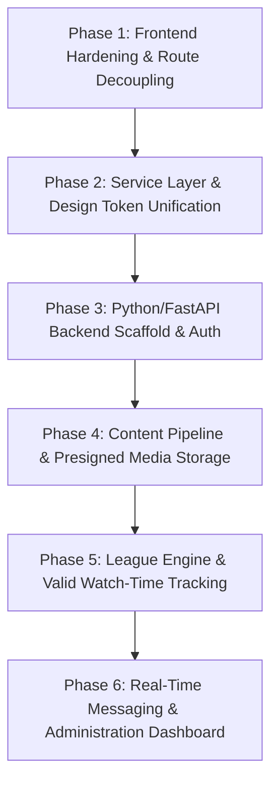

# Uni Vibe — Safest, Prioritized Implementation Roadmap

> **Scope:** Phased execution plan for completing Uni Vibe, resolving architectural bottlenecks, and safely bridging the frontend to a future Python/FastAPI backend.  
> **Investigation Date:** October 2026  

---

## 1. Roadmap Principles & Strategy

1. **Preserve High-Value Work:** Preserve the existing glassmorphic aesthetic, responsive grid system, and component architecture. Avoid rewrites.
2. **Frontend Hardening First:** Resolve existing lint failures, routing misconfigurations, and memory leaks before introducing backend services.
3. **Decouple UI from Mock Data:** Wire the newly drafted service layer (`Frontend/src/services/`) into the UI so switching to a live FastAPI server requires changing only the service implementation, not the component views.
4. **Backend Foundation Before Advanced Features:** Prioritize relational database modeling, secure authentication, student verification gates, and media uploads over complex real-time messaging or live streams.

---

## 2. Implementation Phases

---

### Phase 1: Frontend Hardening & Route Decoupling (Immediate)
*Goal: Fix all existing compilation/lint errors, remove dead-ends, and unblock public navigation.*

- **Tasks:**
  1. **Resolve ESLint Failures:** Eliminate the 30 ESLint errors/warnings across the 12 files identified in the audit (`ProfileHeader`, `Stories`, `StoryViewer`, `VibeCard`, `AuthProvider`, `FeedContext`, `mockRankings`, `Opportunities`, `Profile`, `Rankings`, `SignUp`, `services/*`).
  2. **Decouple `<ProtectedRoute>` in `App.jsx`:** Allow unauthenticated users to access Home (`/`), Feed (`/feed`), Search (`/search`), Rankings (`/rankings`), Universities (`/university/:id`), Department (`/department/:id`), Club (`/club/:id`), and Event (`/event/:id`). Restrict `<ProtectedRoute>` exclusively to `/settings`, `/chat`, `/chat/:id`, `/saved`, and post-creation actions.
  3. **Add Missing Directory Routes:**
     - Create `/universities` page listing all approved universities with search and ranking filters (resolves hardcoded `/university/uni1` link).
     - Create `/clubs` page for inter-campus club discovery (resolves hardcoded `/club/club1` link).
     - Create `/events` page for campus event browsing (resolves hardcoded `/event/ev1` link).
  4. **Add Post Detail Route (`/post/:id`):** Allow direct URL linking and viewing of individual vibes.
  5. **Fix `/upload` Blank Page Defect:** Replace the `null` return in `Upload.jsx` with a dedicated full-page upload composer or redirect back to `/` when dismissed.
  6. **Fix Object URL Memory Leaks:** Add `URL.revokeObjectURL()` cleanup in `UploadModal.jsx` and `Stories.jsx`.
  7. **Remove Formula Leak:** Delete the raw `<pre class="formula-code">` code block in `Rankings.jsx` to satisfy the product rule.
- **Verification Criteria:**
  - `npm run lint` exits with code 0 (zero errors, zero warnings).
  - An unauthenticated visitor can open `/rankings` or `/university/uni1` without being redirected to `/login`.
  - All navigation links in the Left and Right sidebars navigate to real directory pages.

---

### Phase 2: Service Layer & Design Token Unification
*Goal: Connect all UI components to asynchronous service abstractions and establish centralized design tokens.*

- **Tasks:**
  1. **Centralize CSS Design Tokens:** Define a `:root` block in `Frontend/src/index.css` for palette colors (`--bg-primary: #060d18`, `--accent-blue: #2d8cff`, `--glass-bg`, `--glass-border`, `--radius-card: 24px`, `--radius-panel: 30px`).
  2. **Wire Service Modules into React Contexts:**
     - Refactor `FeedContext.jsx` to call `postService.getFeedPosts()`, `postService.toggleLike()`, etc.
     - Refactor `AuthProvider.jsx` to invoke `authService.login()` and `authService.signup()`.
     - Refactor `Rankings.jsx` to fetch data via `rankingService.getLeaderboard()`.
     - Refactor `University.jsx`, `Club.jsx`, and `Event.jsx` to fetch via their respective services.
  3. **Add Mock/Live Environment Toggle:** Update `apiClient.js` to inspect an environment flag (e.g. `VITE_USE_MOCK_DATA=true|false`), allowing seamless switching between local mock datasets and the live backend during staging.
- **Verification Criteria:**
  - Zero direct imports of `mock*.js` files inside React components (`Frontend/src/pages/` or `Frontend/src/components/`).
  - All data operations flow through `Frontend/src/services/`.

---

### Phase 3: Python / FastAPI Backend Scaffold & Auth
*Goal: Establish the server infrastructure, database migrations, and secure authentication boundaries.*

- **Tasks:**
  1. **Initialize `Backend/` Workspace:** Set up FastAPI application structure, Poetry or `uv` dependency management, Ruff linter/formatter, and Pydantic v2 settings.
  2. **Database Foundation:** Configure SQLAlchemy 2.0 (async engine) with PostgreSQL and Alembic for automated database migrations.
  3. **Authentication Engine:**
     - Implement `POST /api/v1/auth/register` with argon2/bcrypt password hashing.
     - Implement `POST /api/v1/auth/token` issuing JWT access and refresh tokens.
     - Implement `GET /api/v1/users/me` resolving authenticated user identity.
  4. **Student Verification System:**
     - Implement `POST /api/v1/users/me/verification` accepting student ID details.
     - Enforce `require_verified_student` dependency on protected endpoints.
  5. **University Directory Endpoints:** Implement `GET /api/v1/universities` and `POST /api/v1/universities/requests`.
- **Verification Criteria:**
  - Automated FastAPI test suite (`pytest`) verifies that non-students and pending students receive `HTTP 403 Forbidden` when attempting to call student endpoints.
  - User can register, login, and fetch `/api/v1/users/me` using real PostgreSQL storage.

---

### Phase 4: Content Pipeline & Presigned Media Storage
*Goal: Enable real image/video uploads and persistent feed delivery.*

- **Tasks:**
  1. **Object Storage Integration:** Configure Cloudflare R2 or AWS S3 with bucket lifecycle rules.
  2. **Presigned Upload Flow:** Implement `POST /api/v1/media/upload-url` generating presigned PUT URLs with file size and MIME-type restrictions.
  3. **Vibe Creation & Feed Engine:**
     - Implement `POST /api/v1/posts` (attaching season ID, university ID, verified author).
     - Implement `GET /api/v1/feed` with cursor-based pagination.
  4. **Video Playback in Frontend:** Implement an HTML5 video player component in `VibeCard.jsx` to replace the static image fallback.
  5. **Post Interactions:** Implement real database toggle endpoints: `POST /api/v1/posts/{id}/like`, `POST /api/v1/posts/{id}/save`, `POST /api/v1/posts/{id}/repost`, and comment threads.
- **Verification Criteria:**
  - A verified student can record/select a video, upload it to S3, publish a vibe, and see it persist across browser refreshes and other devices.
  - Page refresh preserves all likes, saves, and comments.

---

### Phase 5: League Engine & Valid Watch-Time Tracking
*Goal: Implement the inter-university competition rules and tamper-proof scoring.*

- **Tasks:**
  1. **Valid Watch-Time Ingestion:** Implement `POST /api/v1/posts/{id}/views` recording client watch duration; validate `watch_time >= 4.0s`; apply viewer deduplication.
  2. **Asynchronous Scoring Worker:** Build background worker (Celery / ARQ + Redis) to calculate Post PT using the provisional mathematical formula:
     $$\text{Confidence} = \frac{\sqrt{V}}{\sqrt{V} + \sqrt{1000}}$$
     $$\text{Weighted Engagement} = \text{Like Rate} + (5 \times \text{Save Rate}) + (5 \times \text{Repost Rate})$$
     $$\text{Post PT} = \text{Weighted Engagement} \times \text{Confidence} \times 0.01$$
  3. **Seasonal Aggregations:** Aggregate Post PT into University Season PT and Student Contributor PT.
  4. **League Standings Endpoints:** Implement `GET /api/v1/league/leaderboard` and `GET /api/v1/league/highlights`.
- **Verification Criteria:**
  - Standings table in `Rankings.jsx` displays live, server-computed seasonal scores.
  - Frontend client has zero mathematical formulas and submits zero PT points.

---

### Phase 6: Real-Time Messaging & Administration Dashboard
*Goal: Real-time student communication and back-office administrative control.*

- **Tasks:**
  1. **FastAPI WebSockets:** Implement `/api/v1/ws/chat/{id}` backed by Redis Pub/Sub for private messaging.
  2. **Push Notifications:** Set up notification dispatch triggers on post likes, comments, mentions, and league movement.
  3. **Admin Dashboard (`admin_web`):** Initialize admin interface for reviewing student verification documents, approving missing universities, and processing moderation reports.
- **Verification Criteria:**
  - Two browser tabs can exchange chat messages in real time without refreshing.
  - Platform administrator can approve or reject a student verification request and immediately see posting privileges unlocked.
